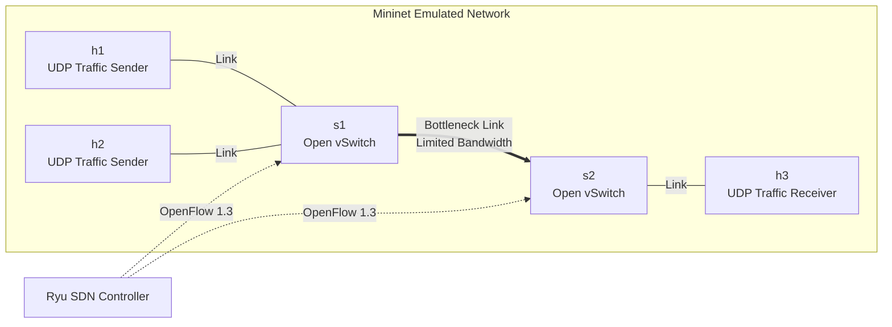

# UDP-Based Traffic Management and Dynamic Prioritization Using SDN

> A Software-Defined Networking (SDN) based traffic management system that generates multiple classes of UDP traffic, detects network congestion, and dynamically prioritizes selected traffic flows to improve Quality of Service (QoS).

---

## 1. Project Overview

Modern computer networks carry different types of traffic simultaneously. However, not all network traffic has the same requirements.

For example:

- **Real-time traffic:** Video calls, voice communication, and online gaming require low latency and minimal jitter.
- **Streaming traffic:** Video and audio streaming require consistent bandwidth and reliable delivery.
- **Background traffic:** File transfers, backups, and bulk data transfers can generally tolerate higher delays.

When multiple traffic flows compete for limited network bandwidth, congestion can occur. This can result in increased latency, packet loss, jitter, and reduced throughput.

Traditional networks generally rely on predefined forwarding and traffic-management configurations. These configurations may not adapt effectively to changing traffic conditions.

This project addresses that problem using **Software-Defined Networking (SDN)**.

We develop a UDP-based traffic generation and monitoring system integrated with an SDN-controlled network. The system identifies different traffic classes, monitors congestion, and dynamically adjusts traffic prioritization to improve network performance.

The project uses **Mininet** to emulate the network, **Open vSwitch (OVS)** as programmable network switches, and an **SDN controller** to manage forwarding and traffic policies.

## 2. Project Objectives

The primary objectives are:

1. Create a virtual network topology consisting of multiple hosts and programmable switches.
2. Generate different classes of UDP traffic simultaneously.
3. Introduce a controlled network bottleneck to simulate congestion.
4. Monitor network performance under different traffic conditions.
5. Use an SDN controller to identify and manage selected traffic flows.
6. Dynamically prioritize important traffic during congestion.
7. Compare network performance with and without dynamic prioritization.

### Expected outcome

The system should demonstrate that dynamically prioritizing latency-sensitive traffic can improve its performance during congestion, compared with a baseline configuration without dynamic prioritization.

---

## 3. Technologies and Tools

| Technology | Purpose |
|---|---|
| Python 3 | UDP applications, controller logic, and monitoring |
| Mininet | Network topology emulation |
| Open vSwitch (OVS) | Programmable virtual switches |
| Ryu SDN Controller | Centralized network control |
| OpenFlow 1.3 | Communication between controller and switches |
| UDP Sockets | Traffic generation and reception |
| Wireshark | Packet inspection and network analysis |
| Linux / Ubuntu | Execution environment |
| Git and GitHub | Version control and collaboration |

---

## 4. System Architecture

The project is organized into three major layers.

### 4.1 Application Layer — UDP Traffic Generation

This layer is responsible for generating and receiving network traffic.

Multiple UDP traffic flows are generated to represent different application requirements.

| Traffic class | Example application | Priority requirement |
|---|---|---|
| Real-time | Voice/video communication | High |
| Streaming | Video streaming | Medium |
| Background | File transfer or bulk data | Low |

Each UDP packet can carry information such as:

- Sequence number
- Timestamp
- Traffic class
- Payload

The receiver can use this information to calculate packet loss and delay-related metrics.

### 4.2 Data Plane — Mininet and Open vSwitch

The data plane represents the actual packet-forwarding network.

It consists of:

- Hosts that generate and receive packets.
- Open vSwitch instances that forward packets.
- Network links connecting hosts and switches.
- A constrained inter-switch link that acts as the bottleneck.

Mininet creates this virtual network and allows us to configure bandwidth, delay, and queue limits.

### 4.3 Control Plane — SDN Controller

The control plane is responsible for managing the network's forwarding and traffic-management policies.

The Ryu controller communicates with Open vSwitch using OpenFlow.

Its intended responsibilities include:

1. Identifying traffic flows using relevant packet-header fields.
2. Monitoring switch statistics.
3. Detecting congestion based on configured thresholds.
4. Assigning higher priority to selected traffic flows.
5. Updating forwarding or queue-related policies.
6. Restoring normal policies when congestion subsides.

**Important:** OpenFlow forwarding rules and actual traffic scheduling are not the same thing. To enforce bandwidth prioritization, the implementation must also configure suitable OVS QoS queues and associate selected flows with those queues.

---

## 5. Network Topology

The network consists of three end hosts connected through two Open vSwitch instances.

The inter-switch link is configured as a bottleneck to create a controlled congestion scenario.

### 5.1 Topology Diagram

The following diagram represents the intended traffic arrangement:



**Diagram explanation:**

- `h1` and `h2` act as traffic-generating hosts in the proposed traffic arrangement.
- `h3` acts as the receiving host.
- `s1` and `s2` are Open vSwitch instances responsible for forwarding packets.
- The link between `s1` and `s2` is the shared bottleneck.
- The Ryu controller communicates with the switches through OpenFlow.

The diagram represents the proposed application-level traffic roles. The actual sender/receiver assignment should match the UDP applications and configuration agreed upon by the team.

### 5.2 Why Two Switches?

Using two switches allows us to create a shared network link through which multiple traffic flows must pass.

For example:

1. `h1` generates real-time traffic.
2. `h2` generates streaming or background traffic.
3. Both traffic flows enter `s1`.
4. Both flows compete for the bandwidth of the `s1`–`s2` link.
5. The traffic reaches `h3` through `s2`.

This creates a controlled environment in which congestion and the effectiveness of traffic prioritization can be studied.

### 5.3 Bottleneck Link

A bottleneck is a network link whose available capacity limits the total traffic that can pass through it.

Suppose two hosts generate traffic at a combined rate greater than the available bandwidth of the inter-switch link.

The link becomes congested, potentially causing:

- Increased packet queuing time.
- Higher end-to-end latency.
- Increased jitter.
- Packet drops.
- Reduced effective throughput.

By limiting the bandwidth of the inter-switch link, we can reproduce this scenario consistently.

### 5.4 Proposed Host Configuration

The following is an example configuration. Actual IP addresses, ports, and bandwidth values should be taken from the topology and traffic configuration files.

| Host | Proposed role | Example IP |
|---|---|---|
| h1 | UDP traffic sender | 10.0.0.1 |
| h2 | UDP traffic sender | 10.0.0.2 |
| h3 | UDP traffic receiver | 10.0.0.3 |

Example traffic-port allocation:

| Port | Traffic class |
|---|---|
| 5001 | Real-time |
| 5002 | Streaming |
| 5003 | Background |

---

## 6. How the System Works

The overall workflow consists of the following stages.

### Stage 1: Network Initialization

Mininet creates the virtual network containing:

- Three hosts.
- Two Open vSwitch instances.
- Host-to-switch links.
- An inter-switch bottleneck link.

The switches connect to the SDN controller using OpenFlow.

### Stage 2: UDP Traffic Generation

UDP sender applications are executed on the selected Mininet hosts.

Different traffic classes are generated with different characteristics, such as:

- Packet size.
- Transmission rate.
- Transmission interval.
- Duration.

For example, multiple traffic generators can transmit simultaneously toward the same receiver.

### Stage 3: Congestion Generation

The traffic flows converge on the limited-bandwidth inter-switch link.

When the combined offered traffic exceeds the available link capacity, congestion can occur.

This provides an environment for evaluating network performance.

### Stage 4: Congestion Detection

The SDN controller monitors network conditions using switch statistics and the configured congestion-detection mechanism.

Possible indicators include:

- Port throughput.
- Queue occupancy.
- Packet drops.
- Link utilization.

The controller compares the observed conditions against predefined thresholds.

### Stage 5: Dynamic Traffic Prioritization

When congestion is detected, the controller applies the configured traffic-management policy.

For example:

- Real-time traffic receives higher priority.
- Streaming traffic receives an intermediate priority.
- Background traffic receives lower priority.

The exact mechanism depends on the implemented OVS QoS and queue configuration.

When congestion subsides, the controller can restore the normal traffic-management policy.

### Stage 6: Performance Evaluation

The receiver and monitoring components collect performance measurements.

The results are recorded and compared between:

1. Baseline network without dynamic prioritization.
2. Network with SDN-based dynamic prioritization.

---

## 7. Performance Metrics

The system evaluates network performance using the following metrics.

### 7.1 Throughput

Throughput represents the amount of data successfully received per unit of time.

\[
Throughput = \frac{Total\ Data\ Received}{Time}
\]

It is generally expressed in bits per second (bps), Kbps, or Mbps.

### 7.2 End-to-End Latency

Latency measures the time taken for a packet to travel from sender to receiver.

\[
Latency = T_{receive} - T_{send}
\]

For one-way latency measurements, sender and receiver clocks must be synchronized adequately.

### 7.3 Jitter

Jitter represents the variation in packet delay.

A simple measurement is the difference between the delays of consecutive packets:

\[
Jitter_i = |Latency_i - Latency_{i-1}|
\]

The average of these differences can be used as a simple jitter indicator.

### 7.4 Packet Loss

Packet loss measures the percentage of transmitted packets that are not received.

\[
Packet\ Loss(\%) =
\frac{Packets\ Sent - Packets\ Received}
{Packets\ Sent}
\times 100
\]

Sequence numbers in UDP packets help identify missing packets.

### 7.5 Link Utilization

Link utilization measures the proportion of available link capacity being used.

\[
Utilization(\%) =
\frac{Observed\ Throughput}{Link\ Capacity}
\times 100
\]

These metrics help determine whether dynamic prioritization improves the performance of important traffic flows.

---

## 8. Team Responsibilities

The project is divided into three major responsibilities.

### Person 1 — Network Topology and Data Plane

Responsibilities:

- Create the Mininet topology.
- Configure hosts and Open vSwitch instances.
- Establish network links.
- Configure the inter-switch bottleneck.
- Configure the remote SDN controller connection.
- Verify connectivity between hosts.
- Assist with OVS QoS and queue integration.

**Primary focus:** Building the network infrastructure through which all traffic flows.

### Person 2 — UDP Traffic Generation and Monitoring

Responsibilities:

- Develop UDP sender applications.
- Develop UDP receiver applications.
- Generate different traffic classes.
- Configure packet sizes and transmission rates.
- Include sequence numbers and timestamps.
- Calculate throughput, latency, jitter, and packet loss.
- Store experimental measurements.

**Primary focus:** Generating realistic network traffic and collecting performance measurements.

### Person 3 — SDN Controller and Dynamic Prioritization

Responsibilities:

- Develop the Ryu SDN controller application.
- Establish communication with Open vSwitch.
- Identify traffic flows.
- Monitor switch statistics.
- Detect network congestion.
- Implement dynamic traffic-prioritization logic.
- Integrate OVS QoS queues and flow policies.
- Record controller decisions.

**Primary focus:** Implementing intelligent network control and congestion management.

### Team Integration

All three components must work together.

The team should agree on:

- Host IP addresses.
- UDP destination ports.
- Traffic-class identifiers.
- Controller IP and port.
- OpenFlow version.
- QoS queue identifiers.
- Congestion thresholds.
- Metric definitions.
- Output CSV format.

---

## 9. Project Directory Structure

A suggested repository organization is:

```text
UDP-SDN-Project/
│
├── topology/
│   └── topology.py
│
├── traffic/
│   ├── udp_sender.py
│   ├── udp_receiver.py
│   └── traffic_config.py
│
├── controller/
│   ├── sdn_controller.py
│   ├── congestion_detector.py
│   └── qos_manager.py
│
├── monitoring/
│   └── metrics.py
│
├── experiments/
│   ├── baseline.py
│   └── qos_test.py
│
├── results/
│   ├── baseline/
│   └── qos_enabled/
│
├── requirements.txt
│
└── README.md
```

The directory structure is a recommended organization. It can be adjusted to match the actual files contributed by each team member.

---

## 10. Installation and Setup

### 10.1 Prerequisites

The project is intended to run in an Ubuntu/Linux environment.

Install the required system packages:

```bash
sudo apt update

sudo apt install mininet openvswitch-switch \
python3 python3-pip git wireshark
```

Verify Mininet:

```bash
sudo mn --version
```

Verify Open vSwitch:

```bash
sudo ovs-vsctl show
```

Verify Python:

```bash
python3 --version
```

### 10.2 Install Python Dependencies

Clone the repository:

```bash
git clone <YOUR_GITHUB_REPOSITORY_URL>
```

Navigate into the project:

```bash
cd UDP-SDN-Project
```

Install the Python dependencies:

```bash
pip install -r requirements.txt
```

The exact dependencies should be listed in `requirements.txt` based on the implemented sender, receiver, monitoring, and controller applications.

### 10.3 Configure Open vSwitch

Ensure the Open vSwitch service is running:

```bash
sudo systemctl start openvswitch-switch
```

Check the service:

```bash
sudo systemctl status openvswitch-switch
```

---

## 11. Running the Project

The following describes the intended execution sequence. Replace script names and arguments with those used in the final implementation.

### Step 1: Start the SDN Controller

In the first terminal:

```bash
ryu-manager controller/sdn_controller.py \
--ofp-tcp-listen-port 6653
```

The controller listens for OpenFlow connections.

### Step 2: Start the Mininet Topology

In another terminal:

```bash
sudo python3 topology/topology.py
```

The topology should connect its switches to the remote controller.

If the controller runs in the same Ubuntu environment, its address is commonly:

```text
127.0.0.1:6653
```

If the controller and Mininet run in different environments, use the reachable controller IP address instead.

### Step 3: Verify the Network

Inside the Mininet CLI:

```bash
nodes
```

Displays the available hosts and switches.

```bash
net
```

Displays the network connections.

```bash
links
```

Displays the configured links.

```bash
pingall
```

Tests connectivity between hosts.

### Step 4: Start the UDP Receiver

Start the receiver on the designated receiving host.

Example:

```bash
h3 python3 traffic/udp_receiver.py
```

### Step 5: Generate UDP Traffic

Start the sender applications on the designated traffic-generating hosts.

Illustrative commands:

```bash
h1 python3 traffic/udp_sender.py --port 5001
```

```bash
h2 python3 traffic/udp_sender.py --port 5002
```

Additional traffic generators can be used to produce background traffic.

These commands are examples; the actual arguments depend on the implemented application interfaces.

### Step 6: Monitor Network Behaviour

Inspect Open vSwitch configuration:

```bash
sh ovs-vsctl show
```

Inspect OpenFlow rules:

```bash
sh ovs-ofctl -O OpenFlow13 dump-flows s1
```

Inspect the second switch:

```bash
sh ovs-ofctl -O OpenFlow13 dump-flows s2
```

Inspect QoS configuration:

```bash
sh ovs-vsctl list QoS
```

Inspect queue configuration:

```bash
sh ovs-vsctl list Queue
```

### Step 7: Stop and Clean Up

Exit the Mininet CLI:

```bash
exit
```

Clean up stale Mininet configurations:

```bash
sudo mn -c
```

---

## 12. Experimental Evaluation

The project should be evaluated using two configurations.

### Experiment A — Baseline Network

In this experiment:

- UDP traffic is generated simultaneously.
- The bottleneck link is active.
- Dynamic traffic prioritization is disabled.
- Network performance is measured.

This experiment establishes the baseline behaviour of the network under congestion.

### Experiment B — SDN-Based Dynamic Prioritization

In this experiment:

- The same UDP traffic workload is generated.
- The same bottleneck configuration is used.
- The SDN controller monitors network conditions.
- Dynamic traffic prioritization is enabled.
- Network performance is measured again.

### Comparison

The results from both experiments are compared.

| Metric | Baseline | SDN Prioritization |
|---|---|---|
| Real-time latency | To be measured | To be measured |
| Real-time jitter | To be measured | To be measured |
| Real-time packet loss | To be measured | To be measured |
| Streaming throughput | To be measured | To be measured |
| Background throughput | To be measured | To be measured |
| Link utilization | To be measured | To be measured |

The expected result is improved performance for high-priority traffic during congestion. The actual outcome must be established through experiments rather than assumed.

---

## 13. Future Improvements

Potential extensions include:

- Implementing more sophisticated congestion-detection algorithms.
- Introducing additional traffic classes.
- Using adaptive thresholds instead of fixed congestion thresholds.
- Visualizing throughput, latency, and packet loss in real time.
- Supporting more switches and hosts.
- Comparing different QoS scheduling policies.
- Automating repeated experiments.
- Exporting experimental results to CSV for analysis.

---

## 14. Key Networking Concepts Demonstrated

This project provides practical experience with:

- User Datagram Protocol (UDP).
- Packet forwarding.
- Network congestion.
- Bandwidth bottlenecks.
- Quality of Service (QoS).
- Software-Defined Networking (SDN).
- Control plane and data plane separation.
- OpenFlow.
- Open vSwitch.
- Network traffic classification.
- Queue management.
- Performance monitoring.

---

## 15. Conclusion

This project demonstrates how Software-Defined Networking can be used to manage network traffic dynamically under congestion.

By combining UDP traffic generation, Mininet-based network emulation, Open vSwitch, and a centralized SDN controller, the system provides a practical environment for studying traffic classification and Quality of Service.

The central idea is to move beyond static forwarding configurations and enable the network to respond dynamically to changing traffic conditions.

The final performance comparison between the baseline and SDN-enabled configurations will help quantify the effectiveness of dynamic traffic prioritization.

---

## Contributors

| Team Member | Responsibility |
|---|---|
| Person 1 | Network Topology and Data Plane |
| Person 2 | UDP Traffic Generation and Monitoring |
| Person 3 | SDN Controller and Dynamic Prioritization |

**Institution:** PES University  
**Project Domain:** Computer Networks / Software-Defined Networking

---

*This README describes the intended system design and execution workflow. Update example commands, configuration values, repository structure, and implementation status to match the final code before submission.*
